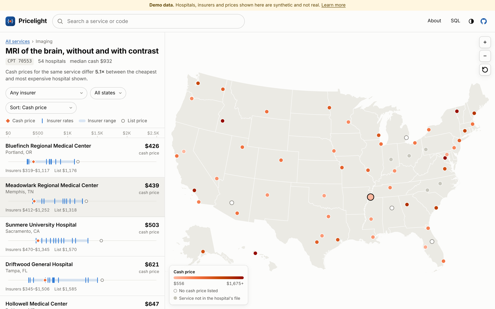
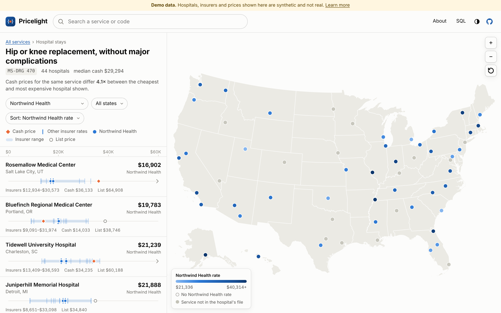
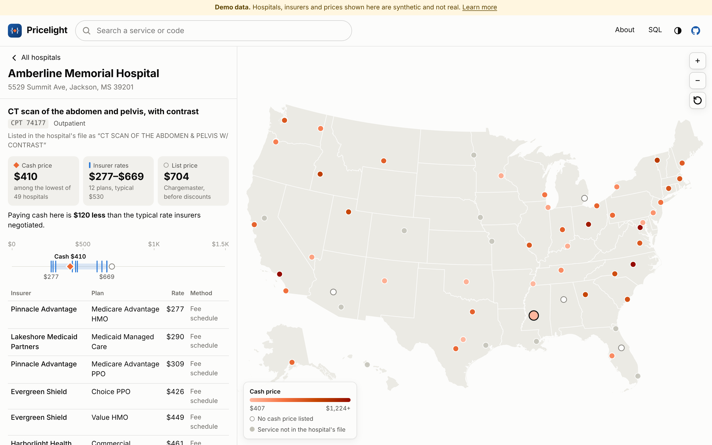
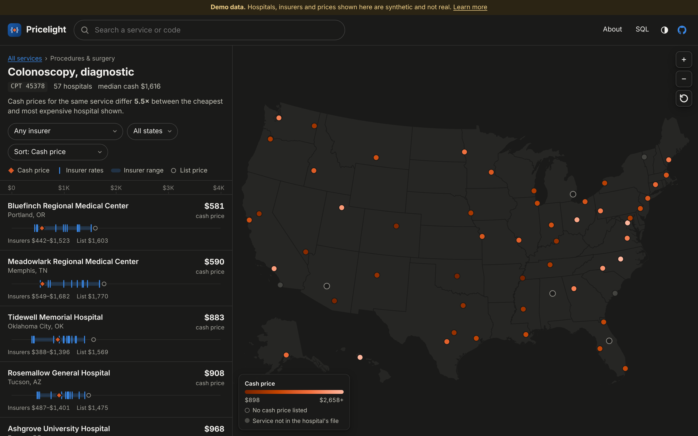
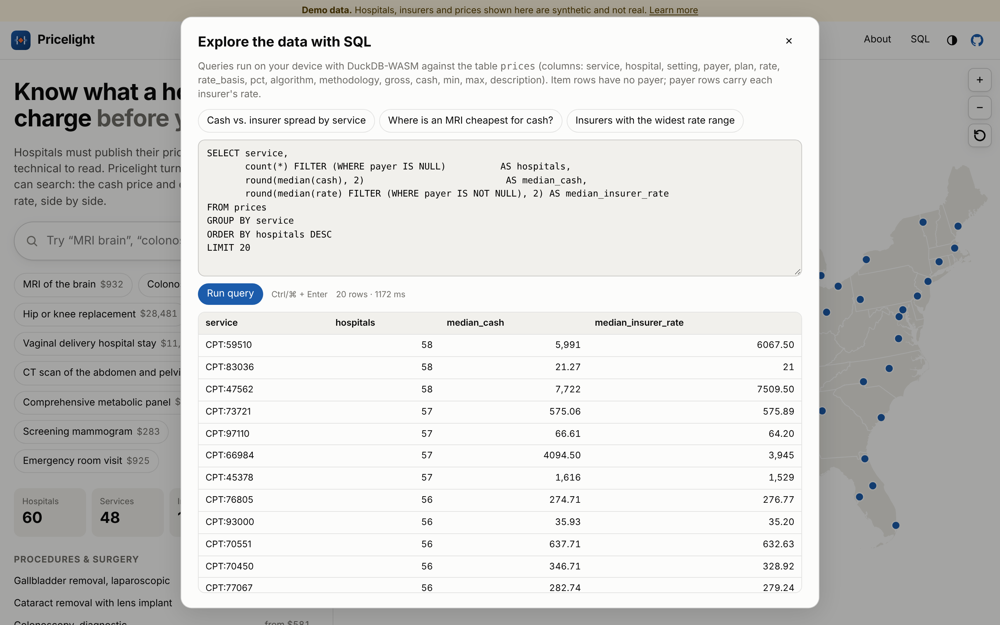
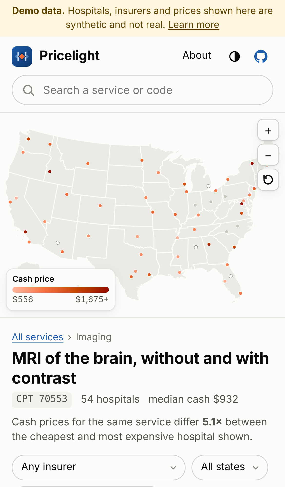
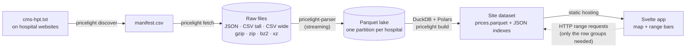

<div align="center">


# Pricelight

**Hospital price search people can actually use.**<br>
Compare a hospital's cash price with every insurer's negotiated rate for the same service, on one map.

[](https://github.com/lobojoel2003/Pricelight/actions/workflows/ci.yml)
[](https://github.com/lobojoel2003/Pricelight/actions/workflows/pages.yml)
[](https://github.com/lobojoel2003/Pricelight/actions/workflows/codeql.yml)
[](https://github.com/lobojoel2003/Pricelight/releases)
<br>
[](LICENSE)
[](parser/LICENSE)
[](pyproject.toml)
[](site/package.json)



<sub>Screenshots show the built-in <b>synthetic demo dataset</b>: fictional hospitals, insurers and prices.</sub>

</div>

---

## Why

US hospitals have had to publish their prices in machine-readable files since 2021 ([45 CFR Part 180](https://www.ecfr.gov/current/title-45/subtitle-A/subchapter-E/part-180)). But the files are huge, technical, and inconsistent, so patients still can't compare what an MRI or a knee replacement costs before they book one.

- In a federal Office of Inspector General sample of 100 hospitals, **34 did not meet the machine-readable file requirements** ([Healthcare Dive](https://www.healthcaredive.com/news/hospitals-noncompliance-price-transparenty-office-inspector-general/732640/)).
- A PatientRightsAdvocate review found **only 21% of 2,000 hospitals fully compliant**, down from 34.5% earlier in 2024, and **532 posted files that failed CMS's own validator** ([Axios](https://www.axios.com/2024/11/20/hospital-price-transparency-dips-report)).

CMS publishes the [file format and a validator](https://github.com/CMSgov/hospital-price-transparency), and a few small open-source parsers exist. What was missing is a **consumer search across every hospital, built in the open**. Pricelight is that: a streaming parser for the files, a pipeline that turns them into one searchable dataset, and a fast, private website on top.

## What you get

|  |  |
|---|---|
| **A map with a price-range bar for every hospital** | Each bar shows the range insurers negotiated (blue band and ticks), the cash price (orange diamond) and the list price (gray ring) on one shared axis, so a glance shows who is cheap, who is expensive and how far apart cash and insurance are. |
| **Your insurer, side by side** | Pick an insurer and the list re-sorts by that insurer's rate, its ticks light up in every bar and the map recolors by it. |
| **Search in plain words** | "knee replacement", "c-section", "mri brain" or a billing code (`70553`, `DRG 470`). 48 common services have plain-language names. |
| **Hospital pages that show their work** | The full insurer/plan table, what the hospital called the service in its file, how fresh the file is and what it got wrong. |
| **Private by design** | The site is static. Prices are read from a Parquet file **inside your browser** with HTTP range requests. No server sees your searches; there are no cookies, analytics or third-party requests (verified in the end-to-end tests). |
| **Built for real files** | The parser streams multi-gigabyte JSON and CSV in constant memory, handles all three CMS layouts and template versions 2.x–3.0, and records every defect it repairs. |
| **SQL for researchers** | An in-browser [DuckDB-WASM](https://duckdb.org/docs/api/wasm/overview) console over the whole dataset, loaded only when opened. |

<table>
  <tr>
    <td width="50%"><br><sub><b>Pick an insurer</b>: sorted and mapped by its negotiated rate.</sub></td>
    <td width="50%"><br><sub><b>Hospital page</b>: every plan's rate, file freshness and quality.</sub></td>
  </tr>
  <tr>
    <td><br><sub><b>Dark theme</b> with its own validated color steps.</sub></td>
    <td><br><sub><b>SQL explorer</b>: DuckDB in the browser.</sub></td>
  </tr>
</table>

<p align="center"></p>

## Try it

**Live demo:** <https://lobojoel2003.github.io/Pricelight/> (deployed by the [Pages workflow](.github/workflows/pages.yml) from `main`, using synthetic demo data).

Run it locally (needs [uv](https://docs.astral.sh/uv/) and Node.js 20.19+):

```bash
git clone https://github.com/lobojoel2003/Pricelight.git
```

```bash
cd Pricelight && make setup
```

```bash
make demo
```

```bash
make dev
```

Then open <http://localhost:5173>. `make demo` generates 60 fictional hospitals' price files in every CMS layout, parses them and builds the site dataset, exercising the same code path as real data.

## How it works



1. **Discover.** Since 2024 every hospital must host a `cms-hpt.txt` file that points to its price file (see the [CMS TXT file generator](https://cmsgov.github.io/hpt-tool/)). `pricelight discover` reads it into a manifest.
2. **Fetch.** `pricelight fetch` streams downloads to disk with conditional requests (ETag / Last-Modified) and retries, so unchanged multi-GB files are not downloaded twice.
3. **Parse.** [`pricelight-parser`](parser/) turns each file into one normalized, tall table (one row per item × payer/plan) and a data-quality report. Ingest runs files in parallel and skips ones that haven't changed.
4. **Build.** DuckDB joins the lake into a compact `prices.parquet` sorted by service with small row groups, plus `services.json`, `hospitals.json` and `payers.json`. Payer names are normalized (`NORTHWIND HEALTH INC` → `Northwind Health`) so one insurer is comparable across hospitals.
5. **Serve.** The Svelte app loads the small JSON indexes, then reads only the Parquet row groups for the service you search ([hyparquet](https://github.com/hyparam/hyparquet)), with no backend at all.

More detail: [docs/architecture.md](docs/architecture.md) · [docs/data-model.md](docs/data-model.md).

## Using real hospital files

```bash
uv run pricelight discover examplehospital.org another-hospital.org
```

```bash
uv run pricelight fetch
```

```bash
uv run pricelight geocode
```

```bash
uv run pricelight run --publish site/public/data
```

```bash
uv run pricelight report
```

```bash
uv run pricelight query "mri brain" --state TX --payer Aetna
```

`discover` writes `data/manifest.csv` (edit it freely: name, address, coordinates, or a local `mrf_path`); `geocode` fills coordinates with the free US Census geocoder; `run` ingests and builds; `report` summarizes file quality across hospitals. See [docs/deployment.md](docs/deployment.md) for hosting your own instance.

## The parser library

`pricelight-parser` is a standalone, **Apache-2.0** Python package that you can use in any project.

```python
from pricelight_parser import open_mrf, to_parquet, record_batch_reader

mrf = open_mrf("12-3456789_example-hospital_standardcharges.json.gz")
print(mrf.format, mrf.header.hospital_name, mrf.header.version)
for row in mrf.rows():                      # streams; constant memory
    if row.code == "70553" and row.payer_name:
        print(row.payer_name, row.plan_name, row.negotiated_dollar)
print([(i.code, i.count) for i in mrf.issues])  # what the file got wrong

result = to_parquet("hospital.csv", "hospital.parquet", constants={"hospital_id": "example"})

import duckdb                                # or query it without writing anything
reader = record_batch_reader("hospital.csv")
duckdb.sql("SELECT payer_name, median(negotiated_dollar) FROM reader GROUP BY 1")
```

```bash
uv run pricelight-parse inspect hospital.json.gz
```

```bash
uv run pricelight-parse validate hospital.csv
```

| Handles | Details |
|---|---|
| Layouts | CMS JSON, CSV "tall", CSV "wide" (payer/plan columns unpivoted) |
| Template versions | v2.0–v2.2 (`affirmation`, `estimated_amount`, `hospital_location`) and v3.0 (`attestation`, `type_2_npi`, median / 10th / 90th percentile allowed amounts, counts) |
| Containers | plain, gzip, zip (picks the data member), bzip2, xz; detected from magic bytes, not extensions |
| Text | UTF-8 with or without BOM, Windows-1252; CRLF; ragged rows; padded headers |
| Repairs, each logged | `$1,020.00` and `N/A` in numbers, `MSDRG`/`rev code` code types, `OP`/`IP` settings, `fee_schedule`, `M/D/YYYY` dates, DRG and revenue-code zero padding |
| Validation | CMS header fields and conditional requirements (methodology "other" needs notes, dollar amounts need min/max, v3 percentage contracts need allowed amounts, NDCs need drug units, …) |

**Throughput** (`scripts/benchmark.py`, one core, Python 3.13): a **1 GB JSON** file (7.3M rows) converts to Parquet in **75 s**; a **1 GB CSV** (8.4M rows) in **105 s**, with **peak memory under 300 MB** for both. Ingest parses many hospitals in parallel.

## Data model

Every file, whatever its layout, becomes the same tall table. Highlights (full reference in [docs/data-model.md](docs/data-model.md)):

| Column | Meaning |
|---|---|
| `code`, `code_type`, `codes` | Billing code chosen for cross-hospital comparison (DRG > CPT/HCPCS > … > CDM), plus every code listed |
| `description`, `setting` | The hospital's own description; inpatient / outpatient / both |
| `gross_charge`, `discounted_cash` | List price and cash price |
| `min_negotiated`, `max_negotiated` | De-identified min / max negotiated charge |
| `payer_name`, `plan_name` | `NULL` on item-only rows |
| `negotiated_dollar`, `negotiated_percentage`, `negotiated_algorithm`, `methodology` | The payer-specific negotiated charge |
| `estimated_amount` (v2), `median_amount`, `p10_amount`, `p90_amount`, `allowed_count` (v3) | Allowed amounts for percentage / formula contracts |

## Design notes

- **Color has a job.** Two identity hues only (insurer = blue, cash = orange), with **shape** as a second channel (tick, diamond, ring) so the bars read without color. The map uses a one-hue sequential ramp in the hue of whatever it shows. Both themes' palettes were checked for color-vision-deficiency separation and contrast with a validator, not by eye ([docs/design.md](docs/design.md)).
- **One axis per list.** All bars share a scale capped near the 95th percentile, so one outlier can't flatten everyone; values beyond it get an overflow chevron.
- **Accessible by default.** The map is supplementary: every row has a full text summary for screen readers, the hospital page has a real table, the search box is a WAI-ARIA combobox, and everything works by keyboard. It respects reduced motion and forced colors.
- **Honest framing.** Every hospital page says plainly that a standard charge is not a quote, and demo data is labeled on every screen.

## Project layout

```
parser/      pricelight-parser: streaming MRF parser library + CLI   (Apache-2.0)
pipeline/    pricelight: discover, fetch, ingest, build, query CLI   (AGPL-3.0)
site/        Svelte 5 + Vite web app (map, range bars, SQL explorer)  (AGPL-3.0)
scripts/     versioning, benchmark
docs/        architecture, data model, design, deployment, releasing
.github/     CI, CodeQL, Pages deploy, tag-driven releases, Dependabot
```

## Development

```bash
make check
```

```bash
make e2e
```

`make check` runs everything CI runs except browsers: version consistency, ruff, strict mypy, svelte-check, prettier, 82 Python tests (with doctests) and the site unit tests. `make e2e` runs the Playwright suite on desktop and phone viewports, including a check that the app makes no third-party requests. CI runs the Python suite on Linux (3.10–3.13), macOS and Windows. See [CONTRIBUTING.md](CONTRIBUTING.md).

## Versioning and releases

Pricelight uses [Semantic Versioning](https://semver.org). One version, in [`VERSION`](VERSION), covers the parser, pipeline and site, and CI fails if any manifest disagrees. Every build is stamped with a **build number** (the CI run number) and **commit**, shown in the site's footer and About dialog and recorded in the dataset's `meta.json`.

Pushing a `vX.Y.Z` tag runs the [release workflow](.github/workflows/release.yml): it verifies the tag matches every component, runs the tests, builds the wheels and sdists, the demo dataset and the static site, writes `BUILD_INFO.json` and `SHA256SUMS.txt`, attests build provenance and publishes a GitHub release with notes from [CHANGELOG.md](CHANGELOG.md). Publishing to PyPI is ready but opt-in. Steps: [docs/releasing.md](docs/releasing.md).

## License

Pricelight is two-licensed **by component**:

- The **website and data pipeline** (`site/`, `pipeline/`, and everything else unless stated) are licensed under the **GNU Affero General Public License v3.0 or later**: see [LICENSE](LICENSE). If you run a modified version as a public service, you must share your changes with its users.
- The **parser library** (`parser/`) is licensed under the **Apache License 2.0**: see [parser/LICENSE](parser/LICENSE) and [parser/NOTICE](parser/NOTICE), so anyone, including commercial and closed-source projects, can reuse it to read hospital price files.

**Data notes.** Prices come from files hospitals publish under federal law. The demo dataset is entirely synthetic: hospital, insurer and person names are invented and any resemblance is coincidental. Billing codes are used as identifiers only; Pricelight does not ship CPT® code descriptors (CPT is a registered trademark of the American Medical Association), and service names shown are its own plain-language labels or the hospital's own descriptions.

## Acknowledgements

[CMS Hospital Price Transparency](https://github.com/CMSgov/hospital-price-transparency) for the open format; [DuckDB](https://duckdb.org), [Polars](https://pola.rs), [Apache Arrow](https://arrow.apache.org), [ijson](https://github.com/ICRAR/ijson), [hyparquet](https://github.com/hyparam/hyparquet), [Svelte](https://svelte.dev), [d3](https://d3js.org) and [us-atlas](https://github.com/topojson/us-atlas) (US Census Bureau boundaries).

<sub>Pricelight is an information tool, not medical, legal or financial advice. Always confirm prices with the hospital and your insurer.</sub>
